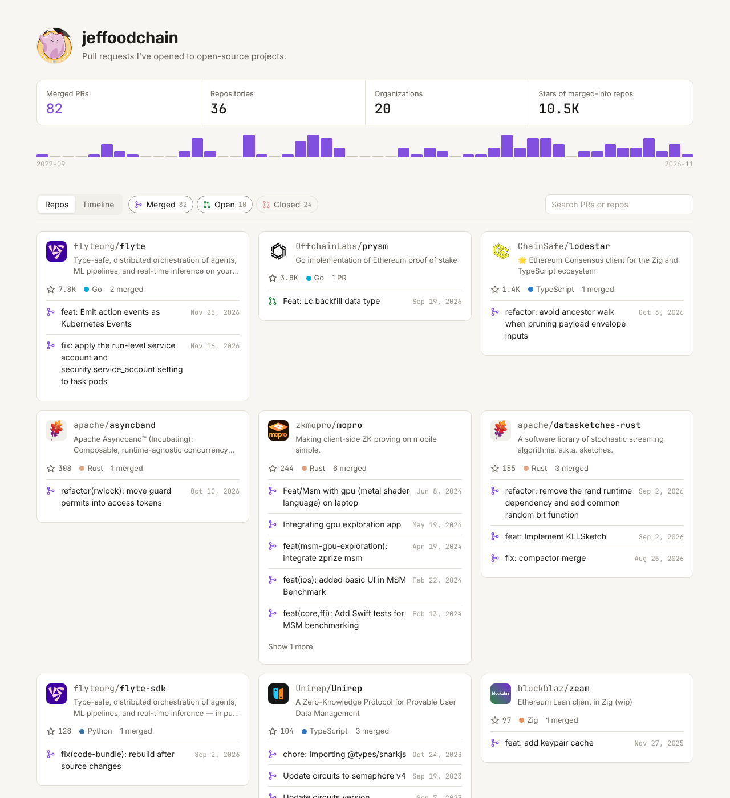

# jc-pr-wall



My own PR wall: every pull request I've opened to someone else's open-source
project, grouped by repository or laid out as a timeline.

It's a static site in `site/` with no build step and no dependencies. A GitHub
Action refreshes the data daily and deploys it to GitHub Pages.

## How it works

- `scripts/fetch-prs.mjs` runs GitHub's search API for `is:pr author:<you> -user:<you>`,
  looks up each repository's stars, language and avatar, and writes `site/data/prs.json`.
  PRs to private repositories are dropped.
- `site/` reads that file in the browser and renders the wall. Filters, search
  and the current view are kept in the URL hash, so a filtered view can be shared.
- `.github/workflows/deploy.yml` runs the tests, fetches fresh data, and deploys
  `site/` to Pages on every push to `main`, once a day, and on demand. If the fetch
  fails, the committed `site/data/prs.json` is deployed as-is.

## Setup

1. In the repository on GitHub, open **Settings → Pages** and set **Source** to
   **GitHub Actions**.
2. Push to `main` (or run the workflow from the **Actions** tab).
3. Optional: add a custom domain under **Settings → Pages → Custom domain**.

## Configuration

Edit `pr-wall.config.json`:

| Key | Meaning |
| --- | --- |
| `username` | GitHub account whose PRs are shown |
| `displayName` | Name in the header (defaults to the username) |
| `tagline` | Line under the name |
| `includeOwnRepos` | Also show PRs to your own repositories |
| `excludeRepos` | Repositories to hide, e.g. `["owner/name"]` |
| `excludeOwners` | Users or organizations to hide entirely |
| `minRepoStars` | Hide repositories with fewer stars than this |

## Local development

```sh
npm test          # unit tests for the data transform
npm run fetch     # needs GITHUB_TOKEN, or a logged-in `gh` CLI
npm run serve     # http://localhost:8000
```
